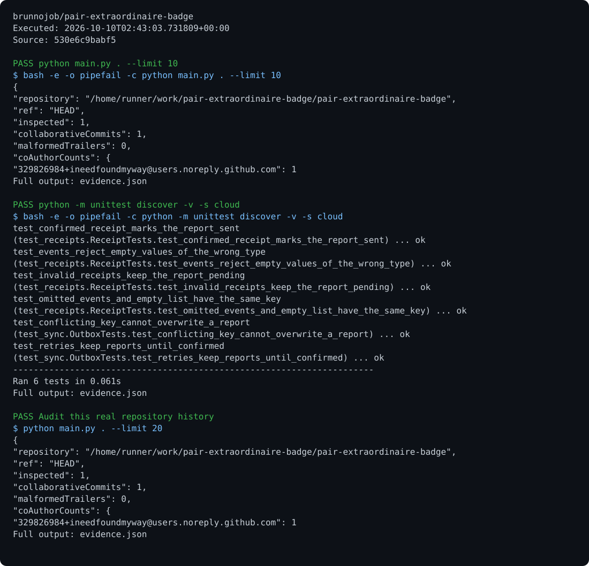

# Git Collaboration Audit

[View execution evidence](https://brunnojob.github.io/devstart-lab/proofs/pair-extraordinaire-badge/)

An audit of Git history, authors, co-author trailers, file changes, and collaboration associated with substantive changes.

## Run

Requirements: Python 3.11+ and Git.

```sh
python main.py . --limit 200 > result.json
```

## Behavior

The tool reads existing history. Invalid trailers are included in the report. Badge automation files and artificial logs are excluded from the count of substantive changes.

## Optional report archive

Export a JSON report from the command above, then run `python cloud/sync.py enqueue result.json --project pair-extraordinaire-badge` and `python cloud/sync.py sync`. Synchronization requires `BRUNNODEV_ACCESS_TOKEN` and the external operations API; the local outbox retains unacknowledged reports.

## License

Original source and documentation are MIT licensed; see [LICENSE](LICENSE). Third-party dependencies and media retain their respective terms. Maintained by [Brunno Dev](https://brunnodev.store).

## Implementation update

The Ruby implementation in `audit.rb` audits real Git history with bounded subprocess output, timeouts, validated references and trailer placement checks. Run `ruby audit.rb . --limit 200` and `ruby -Ilib test/git_audit_test.rb`. The previous Python entry point is retained for compatibility.

Contribution trailer: `Co-authored-by: nyctophile <33561761+ineedfoundmyway@users.noreply.github.com>`.

## Execution proof

[](https://github.com/brunnojob/pair-extraordinaire-badge/actions/workflows/proof.yml)



[Verified run](https://github.com/brunnojob/pair-extraordinaire-badge/actions/runs/38017969572) · [Execution report](docs/proof/evidence.json)

Run `python .proof/record.py` after installing the prerequisites above. The scenarios execute repository code and verify exit codes and expected output. CI publishes `execution-proof` with the transcript, input fingerprints and source commit. The downloadable report identifies the exact tested version; the workflow badge tracks the latest run.
